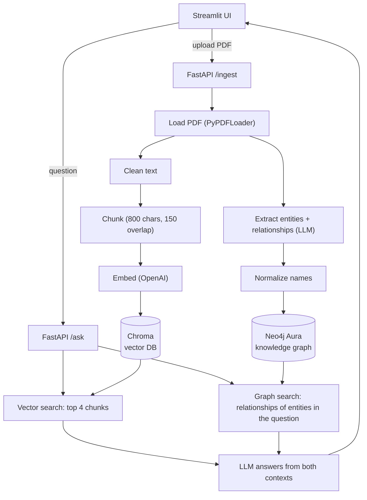

# Hybrid RAG + Knowledge Graph

A PDF question-answering app that combines **vector search** and a **knowledge graph**. Upload a PDF, and it is indexed two ways at once. Questions are then answered using both.

- **Vector search (Chroma)** finds text that is similar in meaning to the question.
- **Knowledge graph (Neo4j)** finds how entities in the document are connected, such as what the backend uses or depends on.

The answer shows exactly what each side contributed: the graph facts used and the pages the vector search returned.

## Architecture



### Ingestion: two pipelines from one PDF

| Pipeline | Steps |
|---|---|
| **1. Vector** | PDF → load → extract text → clean → chunk → embed → Chroma |
| **2. Knowledge graph** | PDF → load → extract text → extract entities → extract relationships → normalize → Neo4j |

### Retrieval: hybrid

1. **Vector search** returns the 4 most similar chunks from Chroma.
2. **Graph search** finds entity names from the graph that appear in the question (for example, "frontend" matches the `Frontend` node). An LLM also suggests extra entity names. Their 1-hop relationships are fetched from Neo4j as facts like `Frontend -[USES]-> Next.js`.
3. The LLM answers using only these two sources, and says so if the answer is not there.

## How the answers are combined

The two retrieval results are combined **inside the prompt**, before the LLM writes the answer. There is no score merging or re-ranking. The code is in `answer_question()` in `backend/app/retrieval/hybrid.py`.

1. **Each search returns a different kind of output.** Vector search returns text chunks tagged with their page number. Graph search returns relationship rows from Neo4j.
2. **Graph rows are turned into plain text lines**, for example `Frontend -[USES]-> Next.js`, so the LLM can read them like any other text.
3. **Both go into one prompt, in two labeled sections**, together with the question:

```
Document excerpts:
[page 1] Frontend:
- Next.js (React + TypeScript) for SSR/SSG and SPA behavior.
- Tailwind CSS with a component library ...

Knowledge graph facts:
Frontend -[USES]-> Next.js
Frontend -[USES]-> Tailwind CSS
Frontend -[USES]-> TanStack Query

Question: What technologies does the frontend use?
```

4. **The LLM writes one answer from both.** The system prompt tells it to use only this context and to say it does not know if the answer is missing.

### Why use both

| Source | Good at |
|---|---|
| Vector chunks | The document's actual wording and detail, with page numbers |
| Graph facts | Completeness and connections: everything linked to an entity, even when it is spread across different chunks or pages |

For example, if a document mentions the backend's databases on pages 2, 4 and 5, vector search may return only two of those chunks, while the graph holds every `USES` link for that entity.

### Which graph entities are used

Graph search does not rely only on the LLM to find entity names in the question. `find_entities_in_graph()` checks every entity name stored in the graph against the question:

- Words are joined without spaces, so "front end" matches `Frontend` and "tan stack query" matches `TanStack Query`.
- Close spellings match too, so the typo "frond end" still finds `Frontend`. This applies only to names of 7 or more letters, to avoid false matches on short names.
- The LLM adds extra name suggestions on top of these.

The app shows the result under each answer: the entities matched, the graph facts used, and the pages the vector search returned.

### Limits

- **No ranking between the two sources.** Both are given to the LLM, which decides what to use.
- **The graph side can be empty.** If no entity in the question matches a node, the prompt says no graph facts were found, and the answer comes from vector search alone.
- **Graph facts are capped** at 25 per entity and are only 1 hop away.

## Tech stack

| Layer | Choice |
|---|---|
| Frontend | Streamlit |
| Backend | FastAPI + Uvicorn |
| Orchestration | LangChain |
| LLM | OpenAI `gpt-4o-mini` |
| Embeddings | OpenAI `text-embedding-3-small` |
| Vector database | Chroma (local, on disk) |
| Graph database | Neo4j Aura Free (cloud) |

## Project structure

```
hybrid-rag-kg/
├── backend/
│   ├── app/
│   │   ├── main.py                  # FastAPI: /health, /ingest, /ask
│   │   ├── config.py                # settings loaded from .env
│   │   ├── ingestion/
│   │   │   ├── loader.py            # PDF loading + text cleaning
│   │   │   ├── vector_pipeline.py   # chunk -> embed -> Chroma
│   │   │   └── graph_pipeline.py    # entities -> relations -> normalize -> Neo4j
│   │   └── retrieval/
│   │       └── hybrid.py            # vector search + graph search + answer
│   ├── data/                        # created at runtime (uploads, Chroma files)
│   ├── test_neo4j.py                # checks the Aura connection
│   ├── test_loader.py               # checks PDF loading and cleaning
│   ├── test_vector.py               # checks the vector pipeline
│   ├── test_graph.py                # checks the graph pipeline
│   ├── test_hybrid.py               # checks hybrid retrieval
│   └── requirements.txt
├── frontend/
│   └── app.py                       # Streamlit UI
├── .env                             # your secrets (never commit this)
└── .gitignore
```

## Setup

### Prerequisites

- Python 3.10 or higher
- An OpenAI API key
- A free Neo4j Aura instance (https://console.neo4j.io)

### 1. Create the environment and install dependencies

```bash
python -m venv venv
source venv/bin/activate          # Windows: venv\Scripts\activate
pip install -r backend/requirements.txt
```

### 2. Create a Neo4j Aura Free instance

1. Sign in at https://console.neo4j.io and create a **Free** instance.
2. Download the credentials file. The password is shown only once.
3. Note the connection URI (`neo4j+s://xxxxxxxx.databases.neo4j.io`) and the instance ID (the `xxxxxxxx` part).

### 3. Create `.env` in the project root

```
OPENAI_API_KEY=your-openai-key
LLM_MODEL=gpt-4o-mini
EMBEDDING_MODEL=text-embedding-3-small
NEO4J_URI=neo4j+s://xxxxxxxx.databases.neo4j.io
NEO4J_USERNAME=neo4j
NEO4J_PASSWORD=your-aura-password
NEO4J_DATABASE=xxxxxxxx
CHROMA_DIR=./data/chroma
UPLOAD_DIR=./data/uploads
```

`NEO4J_DATABASE` is your Aura instance ID. Newer Aura instances do not use `neo4j` as the database name.

### 4. Check the connection

From `backend/`:

```bash
python test_neo4j.py
```

Expected output: `[{'msg': 'Aura connected'}]`

## Run the app

Use two terminals, both with the venv active.

**Terminal 1: backend** (from `backend/`)

```bash
uvicorn app.main:app --reload --port 8000
```

Check http://localhost:8000/health. It should return `{"status":"ok"}`. Interactive API docs are at http://localhost:8000/docs.

**Terminal 2: frontend** (from the project root)

```bash
streamlit run frontend/app.py
```

Open http://localhost:8501.

### Using the app

1. In the sidebar, upload a PDF and click **Ingest PDF**. This takes 30-90 seconds, because it runs both pipelines.
2. Ask questions in the chat box.
3. Open **Graph facts used** under an answer to see the entities matched and the relationships from the graph. The caption below shows which pages the vector search used.

Example questions:

- What technologies does the frontend use?
- Which databases does the backend use?
- How does the message queue fit into the architecture?

## API

| Method | Endpoint | Description |
|---|---|---|
| GET | `/health` | Health check |
| POST | `/ingest` | Upload a PDF (multipart form field `file`). Runs both pipelines and returns page count, vector chunk count and graph stats |
| POST | `/ask` | Body: `{"question": "..."}`. Returns `answer`, `entities`, `graph_facts` and `pages` |

```bash
curl -X POST http://localhost:8000/ingest -F "file=@path/to/document.pdf"
curl -X POST http://localhost:8000/ask -H "Content-Type: application/json" \
     -d '{"question": "What does the backend use?"}'
```

## Design notes

- **Cleaning applies to the vector pipeline only.** The graph pipeline reads the raw page text, as the two pipelines were specified separately.
- **Graph extraction is schema-restricted.** The LLM may only create nodes of type `Layer`, `Technology`, `Service`, `Database`, `Feature` and `Protocol`, and relationships `USES`, `PART_OF`, `DEPENDS_ON`, `STORES_DATA_IN` and `PROVIDES`. This keeps the graph small and readable.
- **Normalization** merges spelling variants such as `Next.js` and `nextjs` into one node, using a manual alias map in `graph_pipeline.py` (`ALIASES`). Add entries there when you see duplicates or odd capitalisation.
- **Re-ingesting the same file name** replaces its vector chunks (chunk IDs are stable) and merges into the same graph nodes, so it does not create duplicates.
- **Chunk sizes differ by pipeline.** The vector pipeline uses 800 characters for precise matching. The graph pipeline uses 1500 characters, so the LLM sees more context per extraction call.

## Troubleshooting

| Problem | Fix |
|---|---|
| `Unable to get a routing table for database 'neo4j'` | Set `NEO4J_DATABASE` in `.env` to your Aura instance ID |
| `CERTIFICATE_VERIFY_FAILED` | Run `pip install --upgrade certifi`. On a Mac with the python.org installer, also run `Install Certificates.command` |
| `ModuleNotFoundError: app...` | Run commands from inside `backend/`, and check that the folders are inside `backend/app/` |
| UI shows "Cannot reach the backend" | Start uvicorn on port 8000 |
| `/ask` returns 422 | The request body must be valid JSON with a `question` field |
| `/ingest` returns 422 | The PDF has no extractable text (scanned image). OCR is not included |
| Duplicate or oddly capitalised graph nodes | Add aliases to `ALIASES`, wipe the graph with `MATCH (n) DETACH DELETE n`, and re-ingest |
| Aura instance is unreachable | Free instances pause after inactivity. Resume it in the Aura console |

## Limitations and future work

- Scanned PDFs are not supported (no OCR).
- Retrieval searches all uploaded documents together. Filtering by `doc_id` would keep documents separate.
- Graph search uses 1-hop relationships. Multi-hop traversal would answer more connected questions.
- Ingestion runs synchronously, so a large PDF keeps the request open. A background job queue would improve this.
- There is no authentication on the API.